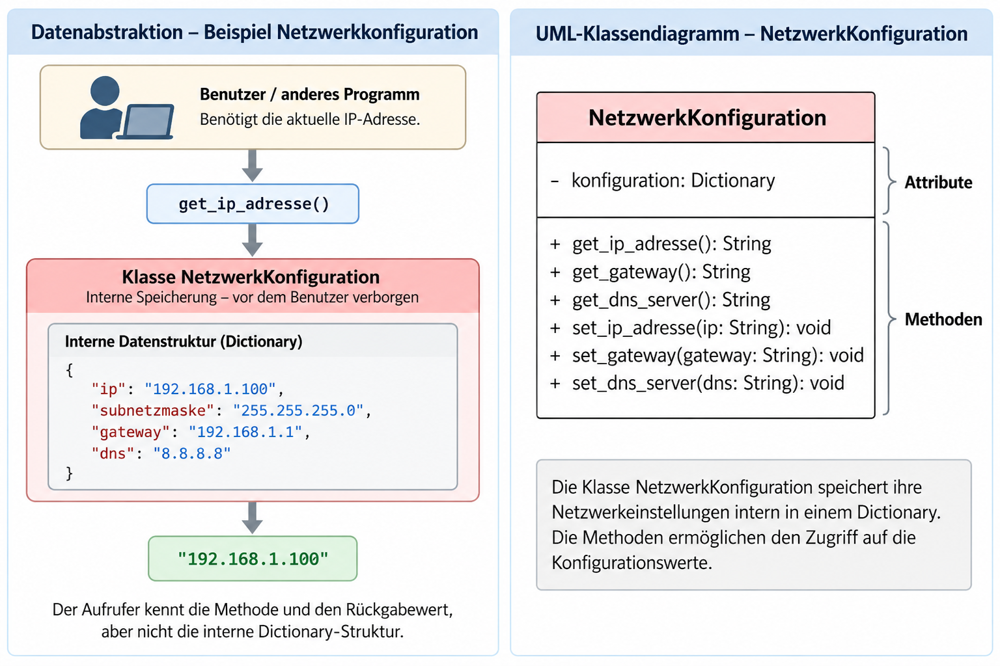

# Netzwerkkonfiguration mit Python

## Projektbeschreibung

Dieses Projekt zeigt die Datenabstraktion
anhand einer Klasse NetzwerkKonfiguration.

## UML-Klassendiagramm



## Datenabstraktion

Die Klasse speichert ihre Netzwerkeinstellungen
intern in einem Dictionary.

Die IP-Adresse wird über die öffentliche
Methode `get_ip_adresse()` abgefragt.

## Python-Beispiel

```python
netzwerk = NetzwerkKonfiguration()
print(netzwerk.get_ip_adresse())
```

## Weitere Informationen

Die interne Datenstruktur kann verändert
werden, ohne die öffentliche Schnittstelle
anzupassen.